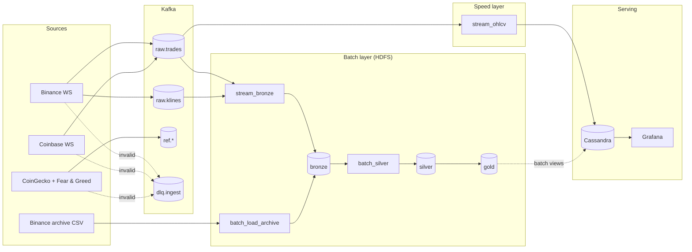

# crypto-stream-lake

A crypto market data pipeline built on the **Lambda architecture**. It collects every trade and 1-minute candle
from Binance and Coinbase in real time, plus asset metadata (CoinGecko) and the Fear & Greed index, through
**Kafka**. **Spark Structured Streaming** turns trades into live 1-minute OHLCV candles in **Cassandra** (speed
layer). Every raw record also lands in an **HDFS** Parquet lake, which **Spark batch** jobs, together with years
of Binance archive history, turn into clean silver and gold tables (batch layer). **Grafana** serves the results.
Everything runs on **Kubernetes** (kind locally).



More detail: [docs/architecture.md](docs/architecture.md).

## Repository layout

| Path | Contents |
|---|---|
| `src/cryptopipe/` | the Python package and the `crypto` CLI |
| ↳ `ingest/` | Binance/Coinbase WebSocket producers, CoinGecko and Fear & Greed pollers, archive download, replay |
| ↳ `schemas/`, `contracts.py`, `config.py` | pydantic message models, topic/lake/table names, `CRYPTO_*` settings |
| ↳ `transforms/` | pure `DataFrame -> DataFrame` functions (normalize, quality, dedupe, OHLCV, archive) |
| ↳ `jobs/` | Spark jobs: `stream_bronze`, `stream_ohlcv`, `batch_load_archive`, `batch_silver`, `profile` |
| ↳ `serving/` | Cassandra writer, Grafana checks, synthetic demo data |
| `tests/` | unit tests (local Spark), integration tests (need the cluster), fixtures |
| `conf/` | tracked symbols, `spark-defaults.conf` |
| `cql/` | Cassandra schema |
| `docker/` | `cryptopipe-spark` and `cryptopipe-ingest` images |
| `deploy/` | kind cluster, Kafka (Strimzi), HDFS, Spark (spark-operator), Cassandra, monitoring, scripts |
| `docs/` | architecture, deployment, data, getting-started guide |

## Requirements

| To... | You need |
|---|---|
| Run the tests and the local demo | Python **3.11** (exactly; 3.12+ is refused), Java 17 (21 also works), Git |
| Run the full pipeline | the above plus Docker (Desktop on Windows/macOS with ≥ 12 GB RAM for its VM, Engine on Linux), kind ≥ 0.27, kubectl ≥ 1.31, helm ≥ 3.14, GNU make, bash (Git Bash on Windows), an **x86-64** CPU |

The cluster images are amd64-only, so on Apple Silicon only the local mode is supported. Step-by-step setup for
each OS, including Docker memory settings: [docs/getting-started.md](docs/getting-started.md).

### Install the tools

**Windows** (PowerShell; open a new terminal afterwards):

```powershell
winget install -e --id Git.Git
winget install -e --id Python.Python.3.11
winget install -e --id EclipseAdoptium.Temurin.17.JDK
# full pipeline only:
winget install -e --id Docker.DockerDesktop
winget install -e --id Kubernetes.kind
winget install -e --id Kubernetes.kubectl
winget install -e --id Helm.Helm
winget install -e --id ezwinports.make
```

**macOS** ([Homebrew](https://brew.sh)):

```bash
xcode-select --install                      # git and make
brew install python@3.11 openjdk@17
# full pipeline only:
brew install --cask docker
brew install kind kubernetes-cli helm

# Homebrew's JDK is not on the path by default; add to ~/.zshrc:
export JAVA_HOME="$(brew --prefix openjdk@17)/libexec/openjdk.jdk/Contents/Home"
export PATH="$JAVA_HOME/bin:$PATH"
```

**Linux** (Ubuntu/Debian):

```bash
sudo apt update
sudo apt install -y git make curl openjdk-17-jdk python3.11 python3.11-venv
# Ubuntu 24.04 has no python3.11 package: run `sudo add-apt-repository -y ppa:deadsnakes/ppa && sudo apt update` first

# full pipeline only:
curl -fsSL https://get.docker.com | sh && sudo usermod -aG docker "$USER"   # then log out and back in
curl -Lo kind https://kind.sigs.k8s.io/dl/v0.27.0/kind-linux-amd64
sudo install -m 0755 kind /usr/local/bin/kind && rm kind
curl -LO "https://dl.k8s.io/release/$(curl -Ls https://dl.k8s.io/release/stable.txt)/bin/linux/amd64/kubectl"
sudo install -m 0755 kubectl /usr/local/bin/kubectl && rm kubectl
curl -fsSL https://raw.githubusercontent.com/helm/helm/main/scripts/get-helm-3 | bash
sudo sysctl fs.inotify.max_user_watches=524288 fs.inotify.max_user_instances=512   # kind needs more inotify watches
```

## Install

```bash
git clone https://github.com/MinhDucNguyen9705/Big-data-Capstone-Project.git crypto-stream-lake
cd crypto-stream-lake
```

On Windows, clone outside OneDrive if you can: syncing `.venv` and Spark output is slow and can lock files.

**Windows (PowerShell):**

```powershell
py -3.11 -m venv .venv
.\.venv\Scripts\Activate.ps1          # if blocked: Set-ExecutionPolicy -Scope CurrentUser RemoteSigned
python -m pip install --upgrade pip
pip install -e ".[dev]"
python scripts/setup_winutils.py      # once: winutils.exe/hadoop.dll so local Spark can write files
```

**macOS / Linux:**

```bash
python3.11 -m venv .venv
source .venv/bin/activate
python -m pip install --upgrade pip
pip install -e ".[dev]"
```

Or `make install` on any OS with GNU make (Git Bash on Windows). The install pulls PySpark (~320 MB). Activate the
environment again in each new terminal (`.\.venv\Scripts\Activate.ps1`, `source .venv/Scripts/activate` in Git
Bash, `source .venv/bin/activate` on macOS/Linux).

Check it:

```bash
crypto --help              # all commands
crypto contracts show      # topics, lake paths, Cassandra tables, active settings
crypto job list            # the Spark jobs
```

## Run locally (no cluster)

```bash
make test                  # or: python -m pytest -m "not integration"
make lint                  # or: ruff check . && ruff format --check .
make demo                  # or: crypto demo local
```

`crypto demo local` runs the 500 fixture trades through parse → validate → dedupe → 1-minute OHLCV in local Spark,
writes bronze, quarantine and candle Parquet under `CRYPTO_LAKE_ROOT` (default `file:///tmp/crypto-lake`) and
prints a summary: 500 rows in, 3 invalid, 5 duplicates removed, 60 candles out.

The real streaming jobs can also read a file instead of Kafka and write Parquet instead of Cassandra:

```bash
crypto job run stream_bronze --local --source tests/fixtures/trades_normalized.jsonl --topic raw.trades --once
crypto job run stream_ohlcv  --local --source tests/fixtures/trades_normalized.jsonl --sink parquet --once
```

On Windows, the `'-' is not recognized` and `Missing Python executable` lines at Spark start-up come from spaces
in the path and are harmless.

## Run the full pipeline (Kubernetes on kind)

Complete walkthrough with checks and troubleshooting: **[docs/getting-started.md](docs/getting-started.md)**.
Short version, from bash (Git Bash on Windows) with the virtual environment activated
(`source .venv/Scripts/activate` in Git Bash, `source .venv/bin/activate` elsewhere):

```bash
make cluster-up                 # kind cluster, namespaces, Strimzi, spark-operator, Prometheus/Grafana (PROFILE=lite for small laptops)
make build-images               # cryptopipe-spark + cryptopipe-ingest, loaded into kind
docker tag cryptopipe-spark:latest cryptopipe-spark:dev
bash -c '. deploy/scripts/lib.sh; kind_load cryptopipe-spark:dev'   # the Spark manifests use the :dev tag
make deploy                     # Kafka + topics, HDFS + lake folders, History Server, Cassandra + schema, monitoring
make smoke SKIP_SPARK=1         # PASS/FAIL per component

# Spark jobs: speed layer, bronze landing, hourly batch refresh
kubectl apply -f deploy/spark/stream-rbac.yaml -f deploy/spark/stream-config.yaml
kubectl apply -f deploy/spark/stream-bronze.yaml -f deploy/spark/stream-ohlcv.yaml -f deploy/spark/batch-silver.yaml

# producers run on the laptop, one terminal each
echo CRYPTO_KAFKA_BOOTSTRAP=127.0.0.1:9092 >> .env          # 127.0.0.1, not localhost (IPv6 hangs on Windows)
crypto ingest binance
CRYPTO_METRICS_PORT=8001 crypto ingest coinbase
crypto ingest coingecko && crypto ingest fear-greed

make port-forward               # Grafana http://localhost:3000, NameNode :9870, History Server :18080
make cluster-down               # delete the cluster and its data
```

Grafana's `admin` password is in a Secret:
`kubectl -n monitoring get secret cryptopipe-grafana-admin -o jsonpath='{.data.admin-password}' | base64 --decode`.
Open the **Crypto market** dashboard (dataset `crypto`, last hour); candles appear a minute or two after the
producers start. Historical backfill from data.binance.vision: [deploy/spark/backfill/README.md](deploy/spark/backfill/README.md).

## Configuration

All settings are `CRYPTO_*` environment variables with local defaults, defined in
[src/cryptopipe/config.py](src/cryptopipe/config.py). Copy [.env.example](.env.example) to `.env` to override them
locally. On Kubernetes they come from the `cryptopipe-env` ConfigMap
([deploy/common/cryptopipe-env.yaml](deploy/common/cryptopipe-env.yaml)). `make help` lists every make target.

## Docs

* [docs/getting-started.md](docs/getting-started.md): install and run everything from zero, troubleshooting
* [docs/architecture.md](docs/architecture.md): Lambda design, data flow, components, contracts summary
* [docs/deployment.md](docs/deployment.md): cluster profiles, addressing, resource requests
* [docs/data.md](docs/data.md): data sources, batch data flow, dataset numbers
* [deploy/README.md](deploy/README.md): platform scripts and cluster troubleshooting; per-component runbooks in
  [hdfs](deploy/hdfs/README.md), [spark](deploy/spark/README.md), [cassandra](deploy/cassandra/README.md),
  [monitoring](deploy/monitoring/README.md)
* [CONTRIBUTING.md](CONTRIBUTING.md): branches, PRs, reviews, contract changes

## Team

| Member | Area | Owns |
|---|---|---|
| A — Đức | Platform | `deploy/`, `docker/`, cluster make targets |
| B — Uy | Ingestion | `src/cryptopipe/ingest/` (except archive, replay) |
| C — Khang | Speed layer | `src/cryptopipe/transforms/`, `jobs/stream_*` |
| D — Kiên | Batch and data | `ingest/archive.py`, `ingest/replay.py`, `transforms/archive.py`, `jobs/batch_*`, `jobs/profile.py`, `docs/data.md` |
| E — Chi | Serving and docs | `src/cryptopipe/serving/`, `cql/`, `deploy/cassandra/`, `deploy/monitoring/`, `docs/` |

Contracts (`contracts.py`, `schemas/`, `config.py`, `conf/symbols.yaml`, `cql/schema.cql`) are shared: changes need
approval from every affected owner ([.github/CODEOWNERS](.github/CODEOWNERS)).

## License

[MIT](LICENSE)
