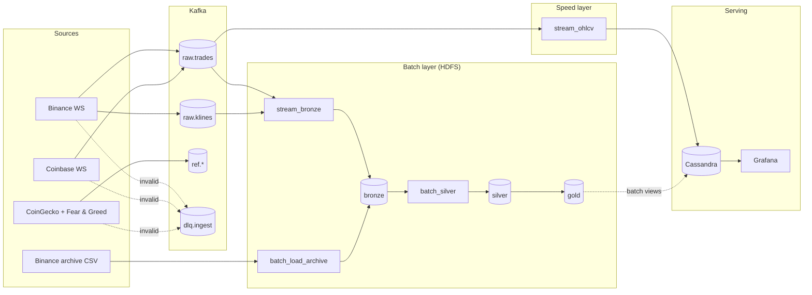

# crypto-stream-lake

A crypto market data pipeline built on the **Lambda architecture**. It collects every trade and 1-minute candle
from Binance and Coinbase in real time, plus asset metadata (CoinGecko) and the Fear & Greed index, through
**Kafka**. **Spark Structured Streaming** turns trades into live 1-minute OHLCV candles in **Cassandra** (speed
layer). Every raw record also lands in an **HDFS** Parquet lake, which **Spark batch** jobs, together with years
of Binance archive history, turn into clean silver and gold tables (batch layer). **Grafana** serves the results.
Everything runs on **Kubernetes** (kind locally, managed cluster later).



Full architecture: [docs/architecture.md](docs/architecture.md). Interfaces between layers: [docs/contracts.md](docs/contracts.md).

## Quickstart (no cluster needed)

Requirements: Python 3.11, Java 17 (21 also works locally), git, GNU make (Linux, macOS, WSL or Git Bash).

```bash
git clone <repo-url> crypto-stream-lake && cd crypto-stream-lake
make install          # .venv + pip install -e ".[dev]"
make test             # unit tests with a local SparkSession
make demo             # = crypto demo local
```

`crypto demo local` runs the 500 fixture trades through parse → validate → dedupe → 1-minute OHLCV in local Spark,
writes bronze, quarantine and candle Parquet under `CRYPTO_LAKE_ROOT` (default `file:///tmp/crypto-lake`) and
prints a summary: 500 rows in, 3 invalid, 5 duplicates removed, 60 candles out.

Without make:

```bash
python3.11 -m venv .venv && source .venv/bin/activate     # Windows: .venv\Scripts\activate
pip install -e ".[dev]"
pytest
crypto demo local
```

**Windows:** Spark needs `winutils.exe` to write files. Run `python scripts/setup_winutils.py` once; it downloads
it into `.tools/hadoop`, which `get_spark(local=True)` picks up. The harmless `'-' is not recognized` and
`Missing Python executable` messages at Spark start-up come from the space in OneDrive-style paths.

Useful commands:

```bash
crypto --help              # every member's entrypoint
crypto contracts show      # topics, lake paths, Cassandra tables, active settings
crypto job list            # Spark jobs with owner and task
make help                  # all make targets
```

Configuration: environment variables `CRYPTO_*` (see [.env.example](.env.example)); every one has a local default.

## Team

| Member | Area | Owns | First tasks |
|---|---|---|---|
| A | Platform | `deploy/`, `docker/`, cluster make targets | A7: kind, Strimzi Kafka, HDFS, spark-operator, images |
| B | Ingestion | `src/cryptopipe/ingest/` (except archive, replay) | A3: Binance/Coinbase producers, pollers, DLQ, metrics |
| C | Speed layer | `src/cryptopipe/transforms/`, `jobs/stream_*` | A5/A6: transforms, `stream_bronze`, `stream_ohlcv` |
| D | Batch and data | `ingest/archive.py`, `ingest/replay.py`, `transforms/archive.py`, `jobs/batch_*`, `jobs/profile.py`, `docs/data.md` | A4/A6/A8: archive, batch jobs, dataset |
| E | Serving and docs | `src/cryptopipe/serving/`, `cql/`, `deploy/cassandra/`, `deploy/monitoring/`, `docs/` | A7 (Cassandra), A9, A10: dashboards, docs |

Contracts (`contracts.py`, `schemas/`, `conf/symbols.yaml`, `cql/schema.cql`, `docs/contracts.md`) are owned by
everyone: changes need approval from every affected owner. Ownership is enforced by [.github/CODEOWNERS](.github/CODEOWNERS).

## After the first push (repo admin, once)

```bash
git remote add origin git@github.com:<org>/crypto-stream-lake.git && git push -u origin main
gh auth login
python scripts/create_issues.py --due <checkpoint-date YYYY-MM-DD>   # labels, milestone, one issue per task
gh issue list --milestone "Checkpoint 1"
```

Then replace `@memberA`..`@memberE` in [.github/CODEOWNERS](.github/CODEOWNERS) with real handles and turn on
branch protection for `main` (see [CONTRIBUTING.md](CONTRIBUTING.md)).

## Docs

* [docs/architecture.md](docs/architecture.md): Lambda diagram, data flow, deployment, components
* [docs/contracts.md](docs/contracts.md): symbols, schemas, topics, lake layout, Cassandra, env vars
* [docs/implementation-plan.md](docs/implementation-plan.md): tasks A1 to A11 and Part B
* [docs/bootstrap-plan.md](docs/bootstrap-plan.md): how this repo was bootstrapped
* [docs/checkpoint-1.md](docs/checkpoint-1.md): definition of done and per-member checklist
* [docs/adr/](docs/adr/): architecture decisions
* [docs/journal/](docs/journal/): engineering journal, one file per lessons-learned category
* [CONTRIBUTING.md](CONTRIBUTING.md): branches, PRs, reviews
* [CLAUDE.md](CLAUDE.md): rules for Claude Code (and humans)

## License

[MIT](LICENSE)
