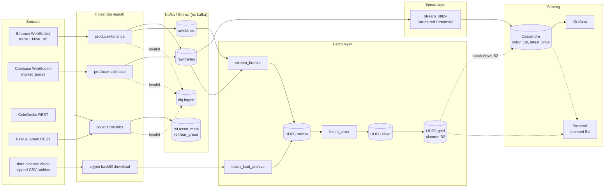
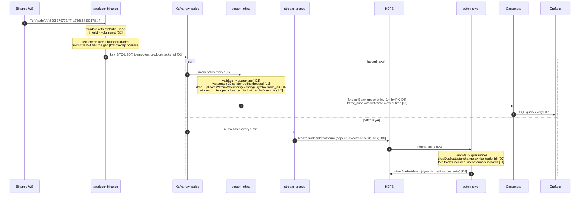
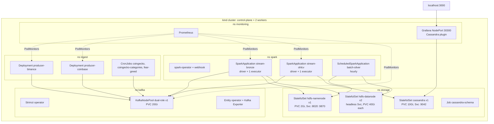

<!-- Owner: E (Serving and docs). Copied from architecture-overview.md by the bootstrap. -->
# Architecture

## 1. Problem and 3V numbers

Crypto markets trade 24/7 on many exchanges. The system collects every trade and 1-minute candle from Binance
and Coinbase in real time, keeps the full history in a data lake, and serves both live candles (seconds of
latency) and historical analytics (indicators, correlations, ML; milestones B2 to B4).

| V | Measured / planned | Source |
|---|---|---|
| **Velocity** | ~130 trades/s on Binance for 12 symbols, ~70/s on Coinbase (30 s sample on 2026-10-19); bursts 10x during volatility; the replayer drives 10-50x for load tests | `crypto ingest binance --dry-run` |
| **Volume** | BTCUSDT alone: ~200 MB of CSV per day (~2.5 M trades); checkpoint dataset: 30 days x 10 symbols trades + 2 years x 50 symbols 1m klines (tens of GB of CSV, several GB of Parquet) | [data.md](data.md) |
| **Variety** | WebSocket JSON (2 exchanges, different schemas), REST JSON (CoinGecko metadata, Fear & Greed index), zipped CSV archives with a timestamp unit change (ms -> us in 2025) | [data.md](data.md) |

## 2. Lambda overview

* **Speed layer**: `stream_ohlcv` turns `raw.trades` into 1-minute candles within ~10-40 s (trigger 10 s +
  watermark 30 s) and upserts them into Cassandra.
* **Batch layer**: `stream_bronze` lands every Kafka record unchanged in HDFS (the immutable master dataset);
  `batch_load_archive` adds years of history from the Binance archive with the same bronze columns;
  `batch_silver` rebuilds cleaned, deduplicated, typed tables hourly. Gold tables and batch views follow in B2.
* **Serving layer**: Cassandra (query-first tables, partition = symbol x day) behind Grafana.

Why Lambda and not Kappa: [ADR 0001](adr/0001-lambda-architecture.md).

## 3. One trade, end to end

Where duplicates (D) and late data (L) are handled:

| # | Place | Mechanism |
|---|---|---|
| D1 | producer / stream / batch | schema + quality rules; rejects go to `dlq.ingest` or `quarantine/` with a reason, never silently dropped |
| D2 | producer after reconnect | gap backfill may re-send trades already sent; tolerated, removed by D4/D7 |
| D3 | producer -> Kafka | `enable.idempotence=true`: broker discards retried batches |
| D4 | stream_ohlcv | `dropDuplicatesWithinWatermark` on the business key, state bounded by the watermark |
| D5 | stream_ohlcv -> Cassandra | upsert by primary key: re-running a micro-batch after a crash rewrites the same rows |
| D6 | stream_bronze | file sink + checkpoint: a batch is committed to `_spark_metadata` exactly once |
| D7 | batch_silver | `dropDuplicates` over all bronze sources (stream + archive overlap) |
| D8 | batch_silver | dynamic partition overwrite: reruns replace partitions instead of appending |
| L1 | stream_ohlcv | trades older than the 30 s watermark are dropped from the live candle (measured in B3) |
| L2 | ohlcv transform | open/close chosen by event time, so out-of-order arrival inside the window is harmless |
| L3 | latest_price | Cassandra write timestamp = event time: an older price can never overwrite a newer one |
| L4 | batch_silver | the batch view includes every late trade; it is the source of truth for history |

## 4. Deployment (kind, local profile)

Memory budget (requests): Kafka 1 GiB, HDFS 1.8 GiB, Cassandra 1.5 GiB, two streaming apps ~6.5 GiB
(driver 1 GiB + executor 1.5 GiB + overhead each), monitoring ~1 GiB. A laptop needs ~14 GiB for Docker.

## 5. Components

| Component | Technology | Role | Why chosen | Alternative considered |
|---|---|---|---|---|
| Producers | Python 3.11, `websockets`, `confluent-kafka`, pydantic v2 | WS/REST -> validated JSON -> Kafka | asyncio fits long-lived sockets; librdkafka idempotent producer; one model per topic | Kafka Connect HTTP source (no WS support), NiFi (heavy) |
| Message queue | Kafka (KRaft) via Strimzi | durable, replayable buffer between ingest and processing; decouples layers | replay for reprocessing, partitioning by symbol, operator-managed on K8s | Pulsar (smaller ecosystem in course), RabbitMQ (no log replay) |
| Stream processing | Spark Structured Streaming 3.5 | speed layer: OHLCV, dedupe, watermarking | one engine and one codebase for batch and stream; course requirement | Flink (better latency, second engine to learn) |
| Batch processing | Spark SQL / DataFrames | bronze -> silver -> gold, analytics, ML | same transforms as streaming, unit tested with local Spark | Hive on Tez, Trino (query only) |
| Distributed storage | HDFS 3.3 | master dataset, Parquet lake | course focus on distributed FS; data locality; block replication visible | MinIO/S3 (ADR 0002, to be written by E) |
| Serving DB | Cassandra 5.0 | low-latency reads of candles and latest prices | write-heavy time series, query-first modelling, linear scaling | MongoDB, Elasticsearch (ADR 0003, to be written by E) |
| Orchestration | Kubernetes (kind -> managed), spark-operator | run everything declaratively, restart on failure | same manifests locally and on cloud | Docker Compose (ADR 0004, to be written by E) |
| Monitoring | kube-prometheus-stack | metrics for producers, Kafka, Spark | standard, PodMonitor CRDs, Grafana included | ELK only (logs, weak metrics) |
| Visualization | Grafana + Cassandra datasource | live candles, pipeline health | no extra service; dashboards as code | Superset (needs SQL engine), Streamlit (planned for analytics) |

## 6. Data contracts

The frozen contracts (symbols, message schemas, Kafka topics, lake layout, Cassandra tables, env vars) are in
[contracts.md](contracts.md), with an example message per topic; `crypto contracts show` prints them from code.
Summary:

| Topic | Key | Partitions | Value |
|---|---|---|---|
| `raw.trades` | canonical symbol | 12 | `Trade` |
| `raw.klines` | canonical symbol | 6 | `Kline` (closed candles) |
| `ref.asset_meta` | canonical symbol | 1, compacted | `AssetMeta` |
| `ref.fear_greed` | `yyyy-MM-dd` | 1, compacted | `FearGreed` |
| `alerts` | canonical symbol | 3 | `Alert` |
| `dlq.ingest` | source | 3 | `DlqRecord` |

Lake (`/lake`): `bronze/{trades,klines,archive_trades,archive_klines}`, `silver/{trades,klines}`, `gold/...`,
`quarantine/{trades,klines}`, `_checkpoints/`, `_profile/`, partitioned by `date` (and `hour` in stream bronze).
Cassandra (`crypto`): `ohlcv_1m`, `latest_price`, `alerts`, `daily_stats` ([cql/schema.cql](../cql/schema.cql)).

## 7. Planned (not built yet)

| Part | Milestone | Notes |
|---|---|---|
| Gold tables (indicators, pivots), batch views in Cassandra | B2 | window functions, pandas UDFs, join strategies, bucketing |
| Hive Metastore (Postgres) | B2 | the checkpoint uses Spark's in-memory catalog; `silver.trades_bucketed` is re-registered by each run |
| Stateful detection, more output modes, exactly-once drill | B3 | `applyInPandasWithState`, alerts topic |
| MLlib, KMeans, GraphFrames, statistics, Streamlit | B4 | GraphFrames jar is already in the Spark image |
| Avro + Schema Registry | B1 | JSON with `schema_version` until then |
| Airflow or justified ScheduledSparkApplication, alerting, Loki | B5 | |
| Security: Kafka TLS + SCRAM, NetworkPolicies, Cassandra auth, HDFS permissions | B5 | the checkpoint runs with PLAINTEXT and permissions off |
| Managed cloud cluster, 3x replication, load and failure tests | B6 | |
