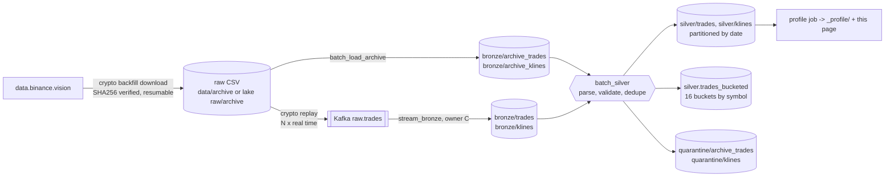

# Data

Owner: **D (Batch and data)**. First version (task A4/A6). The checkpoint dataset numbers (task A8) are filled in
once it is loaded into HDFS on the cluster; until then the tables below come from a local sample run.

Layout, topics and tables are frozen in [contracts.md](contracts.md); this page describes the data that flows
through them.

## 1. Sources

| Source | Endpoint | Format | Limits | Lands in |
|---|---|---|---|---|
| Binance WebSocket (B) | `wss://stream.binance.com:9443/stream` (`<sym>@trade`, `<sym>@kline_1m`) | JSON | 24 h per connection | `raw.trades`, `raw.klines` |
| Coinbase WebSocket (B) | `wss://advanced-trade-ws.coinbase.com` (`market_trades`) | JSON | | `raw.trades` |
| CoinGecko (B) | `/api/v3/coins/markets` | JSON | free tier, < 10 calls/min | `ref.asset_meta` |
| Fear & Greed (B) | `https://api.alternative.me/fng/` | JSON | daily value | `ref.fear_greed` |
| **Binance archive (D)** | `https://data.binance.vision/data/spot/` | zipped CSV + `.CHECKSUM` (SHA256) | none (static files) | `bronze/archive_*` |

### Binance archive files

| Kind | URL pattern | Published | Columns (headerless CSV) |
|---|---|---|---|
| trades | `daily/trades/<SYM>/<SYM>-trades-YYYY-MM-DD.zip` | the next day | `id, price, qty, quote_qty, time, is_buyer_maker, is_best_match` |
| klines 1m | `monthly/klines/<SYM>/1m/<SYM>-1m-YYYY-MM.zip` | after the month ends | `open_time, open, high, low, close, volume, close_time, quote_volume, trades, taker_buy_volume, taker_buy_quote_volume, ignore` |
| klines 1m (current month) | `daily/klines/<SYM>/1m/<SYM>-1m-YYYY-MM-DD.zip` | the next day | same as monthly |

**Timestamp units.** Spot archive files use **microseconds** from 2025-01-01 (16 digits, e.g.
`1756684800178247`) and milliseconds before. Both the batch load (`transforms.archive.epoch_to_ms`) and the
replayer (`ingest.replay.to_ms`) normalize to ms **by magnitude** (`< 1e11` s, `< 1e14` ms, `< 1e17` us, else ns),
so mixed ranges load in one run. Event time in the lake is always UTC ms (`event_ts`).

`is_buyer_maker = true` means the taker sold, so `side = "sell"` (same rule as the live producer).

## 2. Batch layer data flow (owner D)

| Step | Command | Output | Rerun |
|---|---|---|---|
| Download | `crypto backfill download --symbols BTCUSDT --kind trades --start 2025-09-01 --end 2025-09-02 --dest ./data/archive` | `data/archive/<kind>/<SYM>/<file>.csv` (+ `.CHECKSUM`) | skips files already verified |
| Checkpoint download | `make data-download` (30 days trades, 2 years 1m klines, tracked symbols; override `SYMBOLS`, `TRADES_START`, ...) | same | same |
| Replay | `crypto replay --path ./data/archive/trades --speed 50 [--rebase-time] [--dry-run]` | `raw.trades` (+ `dlq.ingest`) | |
| Load bronze | `crypto job run batch_load_archive [--local] --input <dir> [--kind klines]` | `bronze/archive_trades` / `archive_klines`, partition `date` = event date | replaces the date partitions it writes |
| Silver | `crypto job run batch_silver [--local] [--kind trades\|klines\|all] [--dates d1,d2 \| --recent-days N]` | `silver/trades`, `silver/klines`, `quarantine/archive_trades`, `quarantine/klines`, `silver.trades_bucketed` | replaces the date partitions it writes |
| Profile | `crypto job run profile [--local] [--raw ./data/archive] [--detail]` | Markdown on stdout, CSVs in `_profile/` | overwrites |

Without `--input` / `--raw`, `batch_load_archive` and `profile` use the lake landing zone `raw/archive/<kind>`
(`contracts.LAKE_RAW_ARCHIVE`), where the cluster download Job puts the CSVs.

**On the cluster** (runbook: [deploy/spark/backfill/README.md](../deploy/spark/backfill/README.md)):
`archive-download-job.yaml` (download + `hdfs dfs -put` into `/lake/raw/archive`) → `load-archive.yaml` →
`silver-rebuild.yaml` → `profile.yaml`, all on demand. `deploy/spark/batch-silver.yaml` is the hourly
`ScheduledSparkApplication` (`--recent-days 2`) applied by `make deploy WITH_JOBS=1`.

Rules the batch jobs follow:

* **Idempotent reruns**: dynamic partition overwrite by `date`; archive bronze takes `date` from event time,
  so loading the same files again rewrites the same partitions instead of appending.
* **No silent data loss**: `batch_load_archive` refuses to rewrite a date partition that holds symbols not in
  the current run (load all symbols of those days together, or pass `--replace-dates`).
* **One silver schema**: archive rows are stored in bronze as `Trade` / `Kline` JSON (`topic = "archive"`,
  `partition = -1`, `offset` = row number in the file), so silver parses stream and archive bronze the same way.
* **Lambda overlap**: stream and archive carry the same Binance trade ids; silver dedupes on
  `(exchange, symbol, trade_id)` (klines on `(exchange, symbol, interval, open_ts)`).
* **Quarantine, never drop**: rows failing `validate_trades` / `validate_klines` keep a `reason`. Invalid archive
  trades go to `quarantine/archive_trades`, klines to `quarantine/klines`. Invalid trades from stream bronze are
  only counted: `stream_ohlcv` (C) already wrote them to `quarantine/trades`, a streaming file sink that a batch job
  must never write into (`batch_silver` refuses any folder with `_spark_metadata`).
* **Sorted files**: silver is written one task per date, sorted by `symbol, event_ts` (row-group min/max
  statistics then prune by symbol and time).
* **Untracked symbols** (e.g. the extra kline symbols of the checkpoint target) are skipped by
  `batch_load_archive`: silver accepts only symbols in `conf/symbols.yaml`. Adding symbols is a contract change.

## 3. Local sample run (2025-10-22, laptop, `--local`)

BTCUSDT trades 2025-09-01..02 and BTCUSDT + ETHUSDT 1m klines 2025-08..09, downloaded from data.binance.vision
(6 s for 418 MB of CSV) and loaded into a `file://` lake. Output of `crypto job run profile --local --detail`
(per-day kline rows elided, every day has 1,440 candles):

| table | path | size | files |
|---|---|---|---|
| bronze_archive_trades | bronze/archive_trades | 121.1 MB | 2 |
| bronze_archive_klines | bronze/archive_klines | 14.0 MB | 91 |
| silver_trades | silver/trades | 51.6 MB | 2 |
| silver_klines | silver/klines | 9.0 MB | 61 |
| raw_archive_csv | ./data/archive | 417.9 MB | 12 |

Raw archive CSV 417.9 MB -> bronze archive Parquet 135.0 MB (ratio 0.32); silver trades are 51.6 MB for 391.7 MB
of trade CSV (ratio 0.13: typed columns compress far better than the JSON `value` kept in bronze). Sizes in MiB.

| symbol | date | rows | first event (UTC) | last event (UTC) | nulls |
|---|---|---|---|---|---|
| BTC-USDT | 2025-09-01 | 2,729,384 | 2025-09-01 00:00:00.178 | 2025-09-01 23:59:59.376 | 0 |
| BTC-USDT | 2025-09-02 | 2,596,328 | 2025-09-02 00:00:00.138 | 2025-09-02 23:59:59.579 | 0 |

| table | bronze rows | quarantined | duplicates removed | silver rows | null values | dates |
|---|---|---|---|---|---|---|
| trades | 5,325,712 | 0 | 0 | 5,325,712 | 0 | 2 |
| klines | 175,680 | 0 | 0 | 175,680 | 0 | 61 |

Timings (local[*], default 1 GB heap): `batch_load_archive` trades 30.9 s, klines 6.8 s; `batch_silver`
(trades + klines + bucketed table) 146.6 s; replay of one day (2.73 M trades) at full speed in dry-run 11.3 s
(about 240 k msg/s), and `--speed 50` keeps 49x real time.

## 4. Checkpoint dataset (to fill in on the cluster, task A8)

* Target: 30 days of trades for the 10 tracked symbols + 2 years of 1m klines (`make data-download`, then
  `hdfs dfs -put` or `--dest hdfs://...`), `batch_load_archive`, `batch_silver`, `profile`.
* Paste here: symbols, date ranges, number of files, CSV size, Parquet size, rows per symbol/day
  (`crypto job run profile --detail`), and `hdfs dfs -ls /lake/silver/trades`.
* Live data accumulated: messages per topic per day (from `bronze/trades`, `bronze/klines`).
