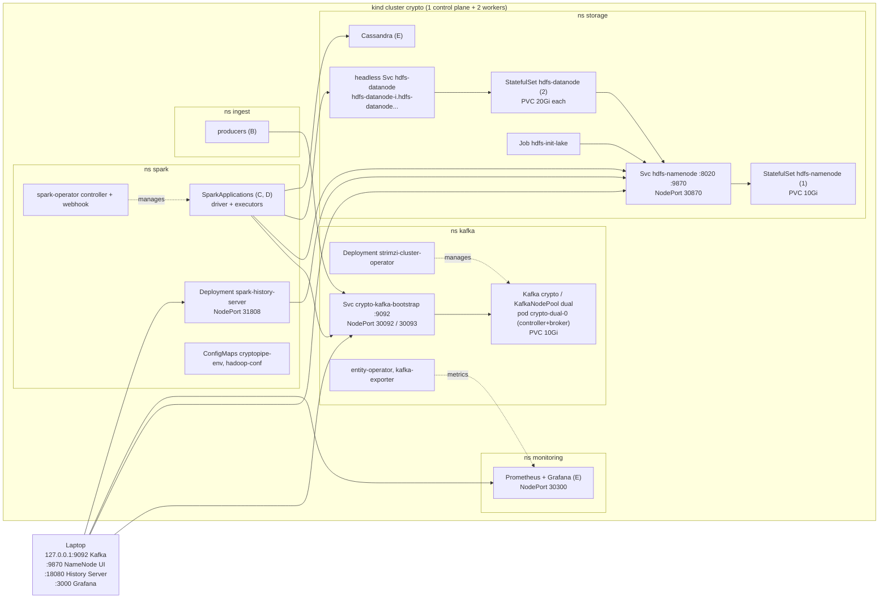

# Deployment

Owner: A (Platform). Platform details behind [architecture.md](architecture.md) section 4; scripts and
troubleshooting in [deploy/README.md](../deploy/README.md).

The whole pipeline runs on Kubernetes: kind on the laptops (`make cluster-up build-images deploy smoke`), the same
manifests with a `cloud` kustomize overlay on a managed cluster. Each layer has its own namespace. Operators
manage the stateful systems: Strimzi runs Kafka in KRaft mode and turns `KafkaTopic` resources, generated from
`cryptopipe.contracts.TOPICS`, into topics; the kubeflow spark-operator turns `SparkApplication` resources into
driver and executor pods. HDFS and Cassandra are StatefulSets with one PersistentVolumeClaim per pod. Every
application pod reads the same `CRYPTO_*` settings from the `cryptopipe-env` ConfigMap, so the code has no
cluster addresses in it.

**Addressing.** In-cluster clients use the contract names: `crypto-kafka-bootstrap.kafka:9092` and
`hdfs://hdfs-namenode.storage:8020`. The NameNode Service is a normal ClusterIP Service, so its address does not
change when the pod restarts. DataNodes register under their stable per-pod DNS names, which Spark pods in other
namespaces resolve through the headless Service. The laptop reaches Kafka through a NodePort listener that
advertises `127.0.0.1:9093`, and the UIs through NodePorts mapped by kind.

**Profiles.**

| | `local` | `lite` | `cloud` (Q2) |
|---|---|---|---|
| Nodes | 1 control plane + 2 workers | 1 + 1 | managed node pools |
| Kafka | 1 dual-role node, RF 1 | 1 node | 3 nodes, RF 3, `min.insync.replicas=2` |
| HDFS | 1 NameNode, 2 DataNodes, replication 1 | 1 DataNode | 3 DataNodes, replication 3 |
| Images | `kind load` | `kind load` | registry |

**Resource requests (local profile, platform only).** Limits in parentheses. The sample SparkApplication adds
2 cores and 2 × 1.4 GiB (1 GiB heap + 384 MiB overhead) while it runs.

| Namespace | Workload | Replicas | CPU request | Memory request (limit) |
|---|---|---|---|---|
| kafka | strimzi-cluster-operator | 1 | 200m | 512Mi (1Gi) |
| kafka | crypto-dual-0 (broker + controller, heap 512m–1g) | 1 | 250m | 1Gi (1.5Gi) |
| kafka | entity-operator (topic + user operator) | 1 | 100m | 384Mi (768Mi) |
| kafka | kafka-exporter | 1 | 20m | 64Mi (128Mi) |
| storage | hdfs-namenode (heap 768m) | 1 | 200m | 512Mi (1Gi) |
| storage | hdfs-datanode (heap 512m) | 2 | 100m each | 384Mi each (768Mi) |
| storage | hdfs-init-lake Job (finishes) | 1 | 100m | 256Mi (512Mi) |
| spark | spark-operator controller + webhook | 1 + 1 | 150m | 192Mi (640Mi) |
| spark | spark-history-server | 1 | 100m | 512Mi (1Gi) |
| **total** | | | **~1.3 cores** | **~4.0 GiB** |
