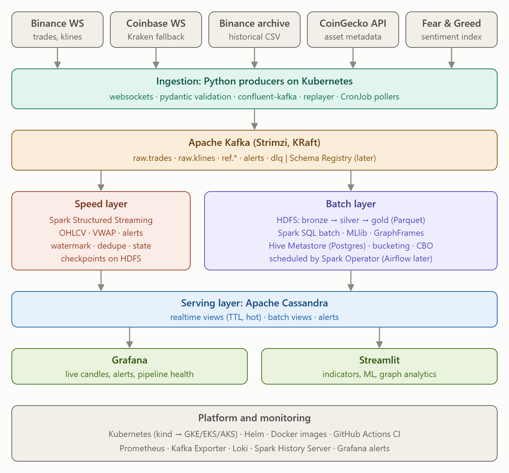

# Bối cảnh dự án và checkpoint

Cập nhật bối cảnh: **2026-10-21**, múi giờ **Asia/Ho_Chi_Minh**.

## Thông tin người dùng đã xác nhận

- Repository: [MinhDucNguyen9705/Big-data-Capstone-Project](https://github.com/MinhDucNguyen9705/Big-data-Capstone-Project).
- Đã clone repo và tạo/checkout branch `speed_layer` từ `main`, tại commit `77acea0`.
- Ảnh người dùng cung cấp là tổng quan kiến trúc của project, sử dụng **Lambda Architecture**.
- `implementation-plan.md` ở thư mục workspace cha là kế hoạch toàn bộ project.
- `bootstrap-plan.md` ở thư mục workspace cha là kế hoạch người dùng đang dùng để chuẩn bị cho checkpoint tuần sau.
- Checkpoint diễn ra **tuần 2026-10-26 đến 2026-11-01** theo cách hiểu tuần kế tiếp từ ngày trao đổi. **Chưa có ngày/giờ cụ thể**; không tự đặt deadline hoặc ngày milestone.
- Phạm vi làm việc hiện tại hướng tới **speed layer** theo branch đã yêu cầu; chưa có xác nhận tên thành viên hoặc phân công cá nhân chi tiết.

## Tài liệu nguồn

| Tài liệu | Vai trò |
|---|---|
| [plans/implementation-plan.md](plans/implementation-plan.md) | Bản sao nguyên văn kế hoạch tổng thể người dùng cung cấp; Part A cho checkpoint, Part B cho các giai đoạn sau |
| [plans/bootstrap-plan.md](plans/bootstrap-plan.md) | Bản sao nguyên văn kế hoạch bootstrap người dùng cung cấp; S1-S10 và handoff |
| [implementation-plan.md](implementation-plan.md) | Bản kế hoạch đã được điều chỉnh trong repository từ trước |
| [bootstrap-plan.md](bootstrap-plan.md) | Bản trong repo ghi S1-S9 đã thực hiện ngày 2026-10-20; đây là thông tin tài liệu, chưa phải kết quả kiểm chứng ở phiên này |
| [contracts.md](contracts.md), [../cql/schema.cql](../cql/schema.cql), [../.env.example](../.env.example) | Contracts và cấu hình dùng khi phát triển/tích hợp |
| [checkpoint-1.md](checkpoint-1.md) | Checklist và kịch bản demo toàn nhóm đang có trong repo |
| [architecture.md](architecture.md), [adr/0001-lambda-architecture.md](adr/0001-lambda-architecture.md) | Mô tả kiến trúc và quyết định Lambda hiện có |
| [../CLAUDE.md](../CLAUDE.md) | Quy ước code, ownership, tests và journal hiện có |

Hai bản nguồn ban đầu nằm tại `/Users/k/Documents/work/2026.1/Big data/capstone_project/implementation-plan.md` và `/Users/k/Documents/work/2026.1/Big data/capstone_project/bootstrap-plan.md`. Các file trong `docs/plans/` lưu nguyên văn để không mất bối cảnh khi đổi máy hoặc mở chat tại repo.

Các câu lệnh giao việc cho Claude Code trong tài liệu là nội dung kế hoạch tham khảo; yêu cầu ở phiên lưu bối cảnh này là lưu thông tin, không phải tự triển khai toàn bộ kế hoạch.

## Kiến trúc đã thống nhất

- **Sources:** Binance WS (trades/klines), Coinbase WS (Kraken fallback), Binance archive CSV, CoinGecko metadata và Fear & Greed sentiment.
- **Ingestion:** Python producers trên Kubernetes, WebSocket, Pydantic validation, confluent-kafka, replayer và CronJob pollers.
- **Kafka:** Strimzi, KRaft; `raw.trades`, `raw.klines`, `ref.*`, `alerts`, `dlq.ingest`. Schema Registry là hạng mục sau.
- **Speed:** Spark Structured Streaming tính OHLCV/VWAP, xử lý watermark/dedupe/state, checkpoint trên HDFS. Stateful alerts đầy đủ thuộc giai đoạn sau checkpoint.
- **Batch:** HDFS bronze → silver → gold (Parquet), Spark SQL batch; Hive Metastore, MLlib và GraphFrames theo các milestone sau.
- **Serving:** Cassandra cho realtime views có TTL, batch views và alerts; Grafana cho live candles/pipeline health; Streamlit cho analytics ở giai đoạn sau.
- **Platform:** Kubernetes (kind trước, cloud sau), Helm, Docker, GitHub Actions, Prometheus; các thành phần monitoring được triển khai theo milestone.

Sơ đồ thể hiện kiến trúc mục tiêu, không khẳng định tất cả thành phần đã được xây dựng. `stream_bronze` là job streaming cấp dữ liệu cho batch lake, được giao cho owner C dù nằm trong nhánh batch của sơ đồ repo.

## Ưu tiên chuẩn bị checkpoint

Theo người dùng, bắt đầu từ kế hoạch bootstrap: packaging/CLI/config/CI, contracts, fixtures, stubs, local demo và workflow nhóm. Theo chính nội dung bootstrap, phần này **không bao gồm** cluster Kubernetes, producers thật, streaming jobs thật hoặc dashboards; đó là phần triển khai tiếp của các thành viên trong Part A. Vì vậy hoàn thành bootstrap không đồng nghĩa hoàn thành checkpoint toàn nhóm.

Mục tiêu checkpoint toàn nhóm theo Part A:

1. Repo có quickstart, CI xanh và tests chạy được.
2. Producers → Kafka → Spark → HDFS bronze và Cassandra OHLCV chạy được; batch archive → bronze/silver.
3. Dataset mục tiêu: 30 ngày trades cho 10 symbols và 2 năm klines 1m cho 50 symbols; ghi số liệu thực trong `docs/data.md`. Nếu giảm quy mô theo điều kiện bandwidth, phải ghi rõ như kế hoạch cho phép.
4. Kiến trúc, contracts, ADRs và kịch bản demo sẵn sàng.
5. Grafana hiển thị candles 1m từ Cassandra.

Phần speed layer dự kiến (owner C theo bản kế hoạch 5 thành viên):

- **A5:** hoàn thiện `transforms/normalize.py`, `quality.py`, `dedupe.py`, `ohlcv.py` và tests; tính OHLCV/VWAP theo event time; kiểm tra duplicates, out-of-order và invalid records.
- **A6:** `jobs/stream_bronze.py` ghi raw JSON cùng Kafka metadata thành bronze Parquet, partition date/hour, checkpoint trên HDFS.
- **A6:** `jobs/stream_ohlcv.py` parse → validate/quarantine → streaming dedupe → candles 1m → Cassandra `ohlcv_1m`/`latest_price`, checkpoint trên HDFS; phối hợp owner E cho Cassandra writer.
- SparkApplication manifests phối hợp owner A; dùng local Spark/file-stream fixtures trước khi cluster sẵn sàng.
- Bằng chứng tích hợp cần có: Parquet trên HDFS và rows trong Cassandra; tests local không thay thế kiểm chứng này.
- Lịch tương đối trong kế hoạch: ngày 5 tích hợp, ngày 6 sửa lỗi/load data, ngày 7 diễn tập. Chưa quy đổi thành ngày cụ thể.

Các tính năng sau checkpoint gồm Avro/Schema Registry, gold/batch views, stateful alerts, exactly-once failure drill, ML/GraphFrames, Streamlit, Airflow, security và cloud/load tests; không tự mở rộng phạm vi sang các mục này.

## Khác biệt cần nhớ trước khi triển khai

- Bản kế hoạch người dùng có phân công **5 thành viên A-E**; bản `docs/implementation-plan.md` hiện có rút phần lịch thành hai người làm song song. Chưa coi cấu trúc nhóm nào là xác nhận nhân sự thực tế.
- A5 mô tả watermark dedupe **2 phút**, A6 mô tả watermark OHLCV **30 giây**, còn `docs/architecture.md` nói watermark 30 giây cho dedupe. Cần đối chiếu code/contracts và chọn hành vi nhất quán khi triển khai; không mặc định vấn đề đã được giải quyết.
- Không ghi đè các bản kế hoạch đang có để che đi khác biệt. Dùng bản gốc người dùng để hiểu ý định, đồng thời tôn trọng contracts hiện có; nếu cần đổi interface thì cập nhật docs và đi qua review của các layer bị ảnh hưởng.
- Chưa chạy tests, local demo hoặc cluster trong phiên lưu bối cảnh. Trạng thái hoàn thành phải dựa trên kiểm tra thực tế ở phiên triển khai tiếp theo.

## Cập nhật triển khai 2026-10-21

- Đã triển khai A5/A6 cho speed layer trên `speed_layer`: transforms, `stream_bronze`, `stream_ohlcv`,
  Cassandra writers, SparkApplication manifests, tài liệu vận hành và ADR 0006.
- `make lint test` với Python 3.11 / Java 17: **93 passed, 13 skipped** (các stub ingestion/batch ngoài scope),
  1 integration test được tách riêng. CLI file-stream cũng chạy thành công.
- Integration test riêng: **1 passed**, dùng Kafka 3.9.1, HDFS 3.3.6 và Cassandra 5.0.6 thật chạy bằng local
  processes; xác minh candle/bronze, recovery, upsert, latest-price writetime và gold finalization.
- Kiểm tra schema manifests qua Spark Operator v2.3.0 CRD đã qua. **Chưa build image hoặc chạy trên Kubernetes**;
  cluster soak, History Server và driver-pod failure drill vẫn cần kiểm chứng ở bước triển khai của nhóm.
- Đọc [speed-layer.md](speed-layer.md) và [journal/streaming.md](journal/streaming.md) để xem cách chạy và giới hạn.
- Môi trường máy này đã có `.venv` (Python 3.11) và Homebrew JDK 17. Khi chạy tests từ terminal mới, đặt
  `JAVA_HOME=/opt/homebrew/opt/openjdk@17/libexec/openjdk.jdk/Contents/Home` (Spark local IP có thể đặt 127.0.0.1).
