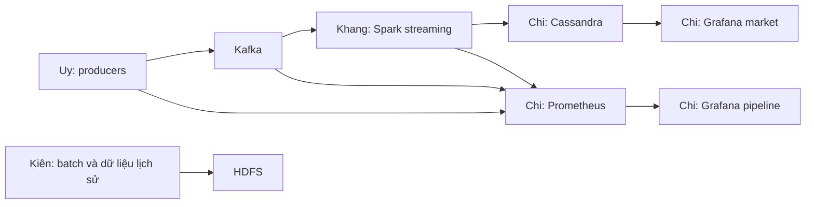

# Phần Serving and docs của Chi — triển khai và giải thích

Ngày chuẩn bị: **24/10/2026**, múi giờ Việt Nam. Phạm vi: owner E, checkpoint A7/A9/A10/A11.

## 1. Bạn đang bàn giao điều gì?

Bạn chịu trách nhiệm để người xem thấy được kết quả của pipeline và nhóm có thể giải thích, chạy lại hệ thống.
Phần triển khai gồm Cassandra trên Kubernetes, Prometheus/Grafana, dashboard thị trường, dashboard pipeline,
công cụ kiểm tra và tài liệu vận hành. Đây là phần code trên nhánh `e/serving-and-docs`, xuất phát từ `main`.

Các câu giao việc trong `bootstrap-plan.md` là nội dung kế hoạch. Phiên triển khai này thực hiện yêu cầu của
bạn cho Serving and docs; trạng thái kiểm chứng được ghi riêng ở mục 10.



Đức cung cấp cluster và quy trình deploy chung. Kiên cung cấp số liệu dataset cho báo cáo. Cassandra và
monitoring dùng các hook mà quy trình deploy của Đức đã hỗ trợ, nên không cần thay code xử lý dữ liệu của Uy,
Khang hoặc Kiên để cài phần này.

## 2. Các file đã thêm có tác dụng gì?

| File/thư mục | Tác dụng |
|---|---|
| `deploy/cassandra/statefulset.yaml` | Chạy Cassandra 5.0.6, có giới hạn bộ nhớ, probe và ổ lưu bền |
| `deploy/cassandra/services.yaml` | Cấp địa chỉ `cassandra.storage:9042` và DNS nội bộ cho node |
| `deploy/cassandra/schema-job.yaml` | Chạy schema sau khi Cassandra sẵn sàng |
| `deploy/cassandra/install.sh` | Dựng Cassandra, tạo ConfigMap từ schema gốc và chờ Job hoàn tất |
| `deploy/cassandra/check.sh` | Kiểm tra bốn bảng; tùy chọn kiểm tra có rows |
| `deploy/monitoring/values.yaml` | Cấu hình Helm cho Grafana, Prometheus, datasource và discovery |
| `deploy/monitoring/generate.py` | Sinh dashboard JSON và ConfigMap từ một nguồn |
| `deploy/monitoring/dashboards/market.json` | Biểu đồ thị trường |
| `deploy/monitoring/dashboards/pipeline.json` | Biểu đồ vận hành pipeline |
| `deploy/monitoring/kafka-podmonitor.yaml` | Cho Prometheus tìm Kafka Exporter của Strimzi |
| `deploy/monitoring/install.sh` | Cài chart đã pin và tự tạo mật khẩu Grafana |
| `deploy/monitoring/port-forward.sh` | Mở Grafana/Prometheus trên localhost |
| `deploy/monitoring/validate.sh` | Render và kiểm tra schema Kubernetes, CRD và shell |
| `src/cryptopipe/serving/seed_demo.py` | Sinh CQL cho dữ liệu giả ở keyspace riêng `crypto_demo` |
| `src/cryptopipe/serving/check.py` | Gọi Grafana API để kiểm tra datasource và từng query |
| `tests/unit/serving/test_deployment.py` | Kiểm tra contracts, ranh giới UTC, demo và PromQL |
| `.github/workflows/serving.yml` | Chạy kiểm tra deployment/dashboard trên GitHub Actions |

Schema Cassandra và writer Spark có sẵn được giữ theo contract. Không cần viết lại phép tính OHLCV hoặc
đổi tên bảng để dùng phần serving này.

## 3. Cassandra làm gì?

Spark tính kết quả và ghi vào Cassandra. Grafana đọc kết quả đã tính để vẽ biểu đồ.

- `ohlcv_1m`: nến từng phút. **O**pen là giá đầu phút, **H**igh cao nhất, **L**ow thấp nhất,
  **C**lose cuối phút, **V**olume là khối lượng. Có thêm số giao dịch và VWAP.
- `latest_price`: giá và thời điểm giao dịch mới nhất cho một symbol/sàn.
- `alerts`: schema dành cho cảnh báo ở giai đoạn sau.
- `daily_stats`: schema dành cho kết quả batch hằng ngày ở giai đoạn sau.

**StatefulSet** giữ định danh node ổn định; **PVC** giữ dữ liệu qua lần tạo lại pod; **Service** cung cấp địa
chỉ ổn định; **Job** chạy việc tạo schema rồi kết thúc. Bản checkpoint dùng một node, replication factor 1.
PVC không thay thế backup hoặc khả năng chịu mất ổ đĩa. Mô hình HA/cloud nằm ngoài bản cài local này.

`install.sh` lấy schema trực tiếp từ `cql/schema.cql`, tránh có một bản schema sao chép lệch với Spark. Rerun
chỉ tạo lại schema Job, giữ StatefulSet/PVC. `CREATE ... IF NOT EXISTS` không tự migrate cột đã có.

## 4. Hai dashboard khác nhau thế nào?

### Market — dữ liệu giao dịch

Mở `/d/crypto-market`. Chọn symbol, sàn và dataset:

- `crypto`: dữ liệu của pipeline live.
- `crypto_demo`: dữ liệu tổng hợp để thử giao diện, luôn được ghi rõ là synthetic.

Các panel: nến một phút, giá mới nhất kèm `event_ts`, số giao dịch/phút, volume/phút và VWAP.
Nến hiện tại còn có thể thay đổi khi micro-batch tiếp theo tới. Latest price không phụ thuộc time picker;
phải xem timestamp để biết nó còn mới hay không.

Dashboard hỗ trợ khoảng thời gian **không quá 24 giờ**, theo UTC. Một khoảng 23:50–00:10 phải đọc cả ngày
trước và ngày sau. Query giới hạn symbol và hai partition ngày ở đầu/cuối khoảng, tối đa 2880 nến.
Nếu tự nhập khoảng dài hơn 24 giờ, các ngày ở giữa sẽ không được đọc; dashboard có thông báo giới hạn này.
Dữ liệu lịch sử dài hạn được phân tích ở nhánh batch.

Ngày partition được Cassandra tính từ epoch milliseconds bằng `toDate((timestamp) ...)`. Không dùng
formatter ngày theo trình duyệt để suy ra partition, vì timezone trình duyệt có thể khác UTC.

Schema đang sắp clustering theo thời điểm rồi mới đến sàn. Vì vậy lọc một sàn sau khoảng thời gian dùng
`ALLOW FILTERING` **trong hai partition đã giới hạn**, không quét toàn bảng. Đây là đánh đổi để giữ contract
hiện tại. Nếu muốn phục vụ lịch sử linh hoạt, nhóm cần thiết kế thêm query/table và review contract.

Theo contract, Coinbase USD được ánh xạ vào symbol chuẩn USDT. Dashboard cho chọn sàn riêng và không giả định
rằng giá USD đã được quy đổi sang USDT. BNB không có nguồn Coinbase trong cấu hình hiện tại.

### Pipeline — hoạt động của hệ thống

Mở `/d/crypto-pipeline`. Nguồn là Prometheus:

| Chỉ số | Cách hiểu đúng |
|---|---|
| Producer enqueue rate | Số message đưa vào producer mỗi giây; chưa phải xác nhận broker đã nhận |
| Delivery errors | Lỗi gửi message mà Kafka callback báo lại |
| DLQ rate | Tốc độ gặp payload không hợp lệ |
| Event lag | Độ chênh `ingest_ts - event_ts` của producer |
| Kafka consumer lag | Chỉ có ý nghĩa cho consumer group đã commit offset |
| Spark input/processing rate | Tốc độ của từng query; không cộng mọi query thành số trade mới |
| Spark trigger duration | Thời gian thực hiện một trigger, đã đổi ms sang giây |
| State rows/memory | Dữ liệu trạng thái Spark giữ để xử lý streaming |
| Scrape health | Prometheus có truy cập được endpoint metrics không |

Spark Structured Streaming lưu offset ở checkpoint, không commit về Kafka. Vì vậy Kafka Exporter không tự
cho biết đầy đủ Spark backlog. Trigger duration cũng không phải latency từ sàn đến dashboard. Panel trống
giữ trạng thái **No data**, không được biến thành số 0 để che việc thiếu metrics.

## 5. Cách cài trên cluster của nhóm

Yêu cầu: Docker/kind cluster của Đức đang chạy, kubectl, Helm 3, Python 3.11; default StorageClass và đủ RAM/disk.
Mặc định script dùng context `kind-crypto`, cùng quy ước với Platform. Chạy từ thư mục gốc repo:

```bash
make install
bash deploy/cassandra/install.sh
bash deploy/monitoring/install.sh
bash deploy/monitoring/port-forward.sh
```

Nếu dùng quy trình chung của nhóm, `make cluster-up`/`make deploy` đã gọi các install hook khi file tồn tại.
Không chạy lại `cluster-up` nếu nhóm đã có cluster đúng context. `PROFILE=lite` vẫn dùng một node Cassandra.

Mở Grafana tại `http://127.0.0.1:3000`; Prometheus tại `http://127.0.0.1:9090`. Đăng nhập `admin`, lấy mật khẩu:

```bash
kubectl --context kind-crypto -n monitoring get secret cryptopipe-grafana-admin \
  -o jsonpath='{.data.admin-password}' | base64 --decode
```

Mật khẩu được sinh ngẫu nhiên lần đầu và giữ trong Kubernetes Secret. Không đưa giá trị này vào repo/báo cáo.
Trên macOS, có thể dùng `base64 -D`. Hướng dẫn chi tiết và lỗi thường gặp:
[Cassandra](../deploy/cassandra/README.md), [monitoring](../deploy/monitoring/README.md).

## 6. Có thể tự làm demo trước khi các bạn khác xong không?

Có. Sau khi Cassandra/schema và Grafana chạy:

```bash
.venv/bin/python -m cryptopipe.serving.seed_demo > /tmp/crypto-serving-demo.cql
kubectl --context kind-crypto -n storage exec -i cassandra-0 -- cqlsh < /tmp/crypto-serving-demo.cql
```

Chọn `BTC-USDT`, `binance`, `crypto_demo` và Last 30 minutes. Bạn sẽ có dữ liệu để thử query/rendering.
Generator chỉ in CQL, không tự kết nối database; tất cả câu ghi nằm trong `crypto_demo`.
Demo này không chứng minh producers, Kafka hoặc Spark đã chạy. Khi tích hợp thật, chuyển Dataset về `crypto`.

## 7. Kiểm tra kết quả thay vì chỉ nhìn pod Running

Kiểm tra local/static:

```bash
make lint test
.venv/bin/python deploy/monitoring/generate.py --check
bash deploy/monitoring/validate.sh
```

Lệnh cuối cần Helm, kubectl và kubeconform; lần đầu tải Helm chart/schema. Promtool 3.2.1 dùng trong test
biểu thức; GitHub Actions cài sẵn cho job serving. Nếu máy không có promtool, test tương ứng sẽ báo skip.

Có thêm integration test cho chính query dashboard. Chỉ chạy vào Cassandra thử nghiệm riêng; test ghi
keyspace `crypto_demo`, không ghi dữ liệu live:

```bash
CRYPTO_SERVING_TEST_HOST=127.0.0.1 .venv/bin/python -m pytest \
  -m integration tests/integration/test_serving.py -q
```

Kiểm tra dịch vụ thật, trong khi port-forward đang chạy:

```bash
export GRAFANA_PASSWORD="$(kubectl --context kind-crypto -n monitoring get secret \
  cryptopipe-grafana-admin -o jsonpath='{.data.admin-password}' | base64 --decode)"
.venv/bin/python -m cryptopipe.serving.check
.venv/bin/python -m cryptopipe.serving.check --dataset crypto_demo
REQUIRE_LIVE=1 bash deploy/cassandra/check.sh
.venv/bin/python -m cryptopipe.serving.check --require-live
unset GRAFANA_PASSWORD
```

Tool HTTP kiểm tra hai datasource, dashboard đã provision và chạy từng query. Có query hợp lệ nhưng trống
sẽ được báo `EMPTY`. Chế độ live cần rows gần đây, latest trade trong vòng 5 phút và metrics producer/Spark
truy vấn được ở thời điểm kiểm tra. Nó từ chối dataset synthetic. Vẫn phải kết hợp test end-to-end của nhóm
và quan sát dữ liệu mới xuất hiện khi pipeline chạy.

## 8. Phối hợp và đầu vào cần từ từng bạn

| Người | Bạn cần xác nhận |
|---|---|
| Đức | Cluster/context, StorageClass, RAM/disk, DNS `cassandra.storage`, port Grafana và các hook deploy |
| Uy | Producer đang expose metrics 8000; pod annotations đúng; có trade thật vào Kafka |
| Khang | Spark nhận đúng Cassandra host/keyspace, ghi được `ohlcv_1m`/`latest_price`; servlet metrics hoạt động |
| Kiên | Số dòng/dung lượng/khoảng ngày thực tế cho `docs/data.md` và báo cáo |

Mẫu annotation của producer và endpoint metrics Spark nằm trong README monitoring. Nếu phải đổi tên bảng,
cột hoặc endpoint dùng chung, cập nhật contracts và review với các owner bị ảnh hưởng.

## 9. Tài liệu và phần trình bày

`docs/architecture.md` giải thích Lambda, một trade đi qua hệ thống và cách triển khai.
ADRs ghi lý do lựa chọn: 0001 Lambda, 0002 Kubernetes, 0003 HDFS, 0004 Cassandra, 0005 JSON/Avro,
0006 event time của speed layer. Không đổi số ADR cũ để khớp một tham chiếu lỗi; sửa liên kết tham chiếu.

Khi trình bày, đi theo thứ tự: bài toán → luồng dữ liệu → dashboard thị trường → dashboard vận hành →
Cassandra/HDFS → cách kiểm chứng. Cho người xem thấy timestamp thay đổi và nến mới, không chỉ trang đăng nhập.
Chụp ảnh thật và ghi thời điểm chạy. Phân biệt dữ liệu synthetic với live trên mọi minh chứng.

Journal ghi lỗi thật theo mẫu: hiện tượng, thử nghiệm, số liệu, cách sửa và bài học. Các bạn tự viết phần
chuyên môn của mình; Chi tập hợp và rà soát tính nhất quán. Không điền số liệu tải hoặc benchmark chưa đo.

## 10. Bằng chứng kiểm chứng trong phiên triển khai

Xem [serving-validation.md](serving-validation.md) để biết lệnh, kết quả và giới hạn kiểm chứng được cập nhật
sau khi hoàn thành kiểm tra. Checklist triển khai và checklist chấp nhận trên cluster là hai việc khác nhau.

Trước khi checkpoint, cần chạy trên cluster nhóm và xác nhận:

- [ ] Cassandra giữ dữ liệu qua lần tạo lại pod, schema Job thành công.
- [ ] Spark ghi rows thật; `latest_price.event_ts` còn mới.
- [ ] Dashboard market hiển thị nến mới và chọn được symbol/sàn.
- [ ] Dashboard pipeline thu được metrics thật; hiểu đúng các panel có thể trống.
- [ ] Các HTTP check và kịch bản demo chạy từ đầu đến cuối.
- [ ] Có ảnh thật, journal và số liệu dataset đã được owner xác nhận.

Streamlit, Loki, alert routing, cloud HA/security và hợp nhất batch/realtime là các milestone sau checkpoint.
