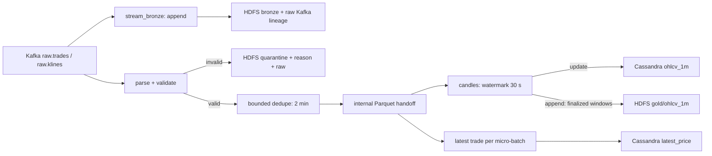

# Speed layer (checkpoint A5/A6)

Owner C. Python 3.11 / Spark 3.5, UTC event time, existing Kafka/lake/Cassandra contracts unchanged.
Entrypoints are `crypto job run stream_bronze` and `crypto job run stream_ohlcv`.

## Data flow



Spark 3.5 does not support chaining multiple stateful operators in **update mode**. The two stateful stages
therefore use separate streaming queries and durable Parquet between them. This follows the
[official Spark workaround](https://spark.apache.org/docs/3.5.6/structured-streaming-programming-guide.html#unsupported-operations).
There is no disabled correctness check and no conversion of streaming dedupe to batch-only dedupe.

`stream_bronze` preserves every payload (including malformed JSON), key, topic, partition, offset and Kafka
timestamp as `contracts.BRONZE_COLUMNS`; dates/hours come from Kafka time, not parsed event time. Trades and
klines have independent sinks/checkpoints. `maxOffsetsPerTrigger` bounds input per query. Default trigger: 1 minute.

`stream_ohlcv` validates required fields, finite positive price/quantity, known exchanges/symbols, side, schema
version, unexpected fields and UTC epoch-ms bounds. Future event time is limited to 5 minutes beyond both
`ingest_ts` and the current clock. Invalid records retain raw JSON, Kafka lineage when present, and a reason.
Malformed event timestamps get the processing date as quarantine partition so they remain inspectable.

Dedupe uses `(exchange, symbol, trade_id)` and `dropDuplicatesWithinWatermark`. Candles use one-minute tumbling
windows, grouped by exchange/symbol. Open/close use `(event_ts, trade_id)` order (string ordering for tied IDs);
VWAP is sum(price * qty) / sum(qty), with zero-volume protection. Default trigger: 10 seconds.

## State, latency and recovery

| Query | Checkpoint relative to CRYPTO_CHECKPOINT_ROOT | Output |
|---|---|---|
| bronze trades/klines | `stream_bronze/raw.trades`, `stream_bronze/raw.klines` | append Parquet, date/hour partitions |
| validated dedupe | `stream_ohlcv/dedupe` | internal `stream_ohlcv/trades` Parquet handoff |
| rejects | `stream_ohlcv/quarantine` | quarantine/trades, date partitions |
| live candles | `stream_ohlcv/candles` | cumulative update-mode upserts |
| latest prices | `stream_ohlcv/latest_price` | newest trade per key in each micro-batch |
| final candles | `stream_ohlcv/gold` | append-only gold/ohlcv_1m |

Watermark is **max observed event time minus delay**, not wall-clock time. The two-minute dedupe watermark
bounds duplicate state; the 30-second candle watermark bounds open candle state separately. Late records may
be discarded by either stage; they remain in bronze for batch recomputation. Live candles update on triggers;
final candles appear only after the watermark passes window end. Idle input does not force-finalize the last
minute. End-to-end latency includes the handoff and downstream triggers; measure it on the deployed workload.

Retain the **entire** checkpoint root, including the internal handoff. It is durable replay input, not disposable
scratch space. It currently accumulates files; automated retention/compaction requires coordinating every
consumer's offsets and is deferred. Do not delete it while retaining downstream checkpoints.

Use exactly one active job per configured output/checkpoint set. Restart with the same code, sources, state
schema, watermarks, output paths and checkpoint locations. Initial Kafka offsets only apply to a fresh query.
Do not reset a checkpoint into existing file-sink directories. `crypto demo local` uses overwrite: give it a
separate lake root from any running streaming jobs.

File sinks use Spark's metadata/checkpoint commit protocol. Cassandra foreachBatch is at-least-once:
`ohlcv_1m` upserts the full cumulative candle by its primary key, so replaying a batch preserves values/row count;
`updated_at` and table TTL can refresh. Writes across Cassandra and HDFS are independent, not an atomic
transaction. `latest_price` uses exchange event time * 1000 as the connector's per-row `writetime`, preventing an
older event from overwriting a newer event. Equal-millisecond conflicting prices remain subject to Cassandra's
cell tie resolution; trade ID breaks ties only within a micro-batch. No stronger exactly-once claim is made.

## Local file-stream run

Use a directory containing only normalized contract JSONL files (or one file / a glob). Files are treated as
new immutable batches: append a new file instead of modifying a previously seen file. This source synthesizes
a Kafka-shaped envelope for testing; it has no genuine Kafka offsets. It is not a replacement for broker tests.

```bash
make install
export JAVA_HOME=/path/to/jdk17
export CRYPTO_LAKE_ROOT=file:///tmp/crypto-speed-demo
export CRYPTO_CHECKPOINT_ROOT=file:///tmp/crypto-speed-demo/_checkpoints
.venv/bin/crypto job run stream_bronze --local \
  --source tests/fixtures/trades_normalized.jsonl --topic raw.trades --once
.venv/bin/crypto job run stream_ohlcv --local \
  --source tests/fixtures/trades_normalized.jsonl --sink parquet --once
```

`--once` uses **AvailableNow**. It first drains dedupe/quarantine, then drains downstream consumers. The local
Parquet sink is explicit (`--sink parquet`); `--local` alone still writes Cassandra. Preview update batches live
under `<lake>/_preview/{ohlcv_updates,latest_price}/batch_id=N`. They are update history, not finalized tables.
For candles select the greatest batch_id per `(symbol, exchange, window_start)` to reconstruct the current view.
For latest prices take the greatest `(event_ts, trade_id)` per `(symbol, exchange)` over all preview batches.
Gold contains only finalized candles, so it can have fewer rows than the update preview after AvailableNow.

Job help and tuning:

```bash
.venv/bin/python -m cryptopipe.jobs.stream_ohlcv --help
.venv/bin/python -m cryptopipe.jobs.stream_bronze --help
```

Both accept `--trigger`, `--starting-offsets`, `--max-offsets-per-trigger`, `--max-files-per-trigger` and `--once`.
OHLCV additionally accepts `--dedupe-watermark`, `--candle-watermark`, `--sink`. Bronze accepts `--topic` (both raw
topics by default on Kafka; required for file input). Endpoints come from `CRYPTO_*` settings. Kafka/Cassandra
jars are supplied by the Spark image or spark-submit, never downloaded by application code.

## Verification and cluster handoff

```bash
make lint test
# Against a disposable, otherwise idle test cluster with connector jars already configured:
export CRYPTO_SPEED_TEST_LAKE_ROOT=hdfs://your-namenode:8020/speed-test-unique-run
# Set the existing CRYPTO_KAFKA_*, CRYPTO_CASSANDRA_* settings for that cluster/keyspace too.
make test-integration
```

The integration gate requires existing raw topics and the Cassandra schema, and refuses an existing HDFS test
root. Use an isolated Kafka broker/topics and Cassandra keyspace: it writes BTC-USDT fixture rows. It compares
Cassandra candles with the same raw trades landed in HDFS, retries a candle upsert, recovers both jobs and tests
that an old latest-price write cannot regress the serving view. It does not provision platform A/E's services.

For Kubernetes use [deploy/spark/README.md](../deploy/spark/README.md). A long cluster run, History Server check
and driver-pod failure drill must be recorded separately from local file-stream tests.

Every completed micro-batch produces a JSON `streaming_batch` log with query, batch ID, input rows, watermark,
rows dropped by watermark, state rows and durations. Late-drop counts come from Spark's state-operator metrics,
not a guessed comparison against the wall clock. Count small files in bronze during a real run and record
latency/throughput, resource use and recovery results in [journal/streaming.md](journal/streaming.md).
